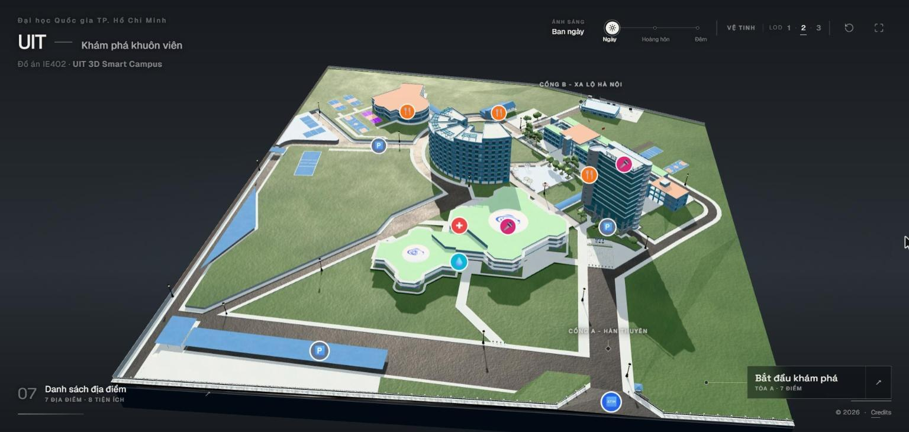
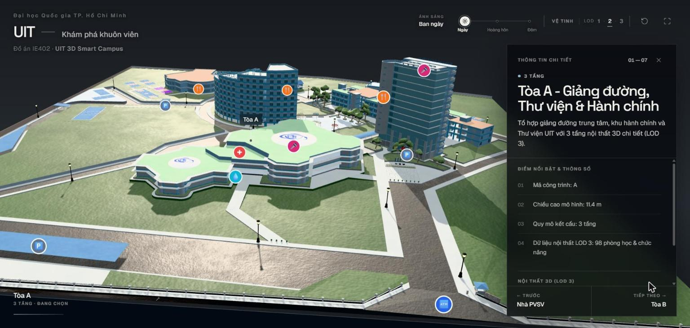
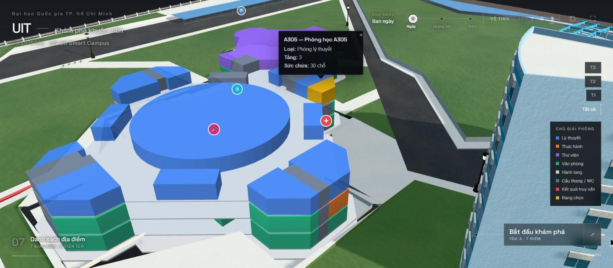
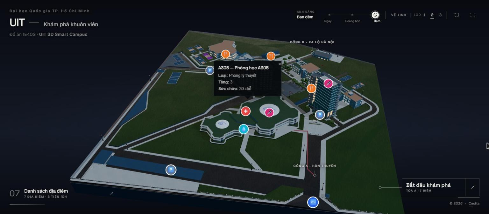

# UIT 3D Smart Campus WebGIS (IE402)

Hệ thống WebGIS 3D phục vụ **số hóa dữ liệu khuôn viên** và các chức năng **tra cứu, truy vấn, định vị** cho Trường Đại học Công nghệ Thông tin (UIT – ĐHQG-HCM): tra cứu phòng học theo tầng, tiện ích xung quanh và dẫn đường liên tầng. Hệ thống không phải tour tham quan: không có ảnh 360° hay virtual tour.

**Toàn khuôn viên:** LOD 1 – LOD 2 (ranh giới, khối nhà, mô hình `.glb`). **Trong nhà (LOD 3):** bóc tách từng tầng cho **Tòa A, B, C, E**; Tòa A có thêm đồ thị dẫn đường trong nhà.



| Thông tin tòa nhà | Trong nhà Tòa A (LOD 3) | Ban đêm + chỉ đường đến A305 |
|---|---|---|
|  |  |  |

## Mục lục
[Chạy nhanh (Docker)](#chạy-nhanh-docker) · [Chức năng](#chức-năng) · [Công nghệ](#công-nghệ) · [Cấu trúc thư mục](#cấu-trúc-thư-mục) · [API backend](#api-backend) · [Dữ liệu](#dữ-liệu) · [Kiểm thử](#kiểm-thử) · [Giới hạn và hướng xử lý](#giới-hạn-và-hướng-xử-lý) · [Tài liệu chi tiết](#tài-liệu-chi-tiết) · [Thành viên](#thành-viên) · [Nguồn tham khảo và giấy phép](#nguồn-tham-khảo-và-giấy-phép)

## Chạy nhanh (Docker)
**Máy chưa có Docker?** Cài một lần trên Windows 10/11:
1. Mở PowerShell bằng **Run as administrator**, chạy `wsl --install --no-distribution`, rồi **khởi động lại máy** (báo lỗi virtualization → vào BIOS/UEFI bật Intel VT-x hoặc AMD-V/SVM).
2. Tải và cài [Docker Desktop](https://www.docker.com/products/docker-desktop/) (hoặc `winget install -e --id Docker.DockerDesktop`), có thể phải khởi động lại máy lần nữa.
3. Mở **Docker Desktop**, đợi hiện **Engine running** (không cần đăng nhập). Kiểm tra: `docker run --rm hello-world`.

macOS/Linux: cài [Docker Desktop](https://docs.docker.com/desktop/) hoặc Docker Engine + plugin Compose.

Khi Docker Desktop đang chạy:
```powershell
git clone https://github.com/LiQiye2507/GIS_3D.git
cd GIS_3D
docker compose up -d --build --wait
```

- Website: http://localhost:5500 · Tài liệu API: http://localhost:8000/docs
- Chi tiết (cài Docker/WSL, kết nối CSDL, reset dữ liệu): [docs/DOCKER.md](docs/DOCKER.md). Chạy không cần Docker: [docs/INSTALL_WINDOWS.md](docs/INSTALL_WINDOWS.md).

## Chức năng
Cách thao tác chi tiết (camera, phím tắt, từng panel): [docs/USER_GUIDE.md](docs/USER_GUIDE.md).

### A. Cốt lõi
| # | Chức năng | Mô tả ngắn | Module |
|---|---|---|---|
| 1 | Cảnh 3D nhiều mức chi tiết | Chuyển LOD 1 (khối extrude) / LOD 2 (mô hình `.glb`) / LOD 3 (nội thất), camera bàn xoay, nền vệ tinh. | `layers.js`, `campus/scene.js` |
| 2 | Mô hình trong nhà theo tầng | Xem trong nhà Tòa A, B, C, E và chọn tầng, vỏ tòa được ẩn. | `layers.js` |
| 3 | Xem thông tin khi bấm | Bấm vào tòa, phòng, tiện ích để hiện thẻ thông tin. | `buildings.js`, `rooms.js`, `amenities.js` |
| 4 | Tìm kiếm | Gợi ý khi gõ, không cần dấu, chịu gõ sai nhẹ, ưu tiên đúng mã phòng. | `search.js` |
| 5 | Định vị kết quả | Camera bay tới, tô vàng phòng, tự chuyển đúng tòa và tầng. | `rooms.js` |
| 6 | Lớp tiện ích theo danh mục | Biểu tượng và màu theo loại, bật/tắt từng loại. | `amenities.js` |
| 6b | Sân thể thao | Tô viền khi rê chuột, bấm để xem thông tin sân, tìm được theo tên/mã. | `sports.js` |

### B. Nên có
| # | Chức năng | Mô tả ngắn | Module |
|---|---|---|---|
| 7 | Tô màu theo chức năng | Phòng tô theo `room_type`, tòa nhà LOD 1 tô theo nhóm chức năng. | `layers.js`, `buildings.js` |
| 8 | Liên kết chia sẻ + mã QR | `?room=A305` / `?building=E` mở thẳng tới đối tượng, kèm mã QR. | `share.js` |
| 9 | Vị trí của tôi | GPS qua Geolocation API, vẽ vòng tròn sai số, báo lỗi rõ ràng. | `geolocate.js` |
| 10 | Chỉ đường | Tuyến `pgr_dijkstra` đến phòng, kèm quãng đường và thời gian đi bộ. | `route.js`, `route_service.py` |
| 11 | Giao diện điện thoại | Màn hình ≤ 720 px dùng bottom sheet và nút lớn. | `style.css` |

### C. Nâng cao
| # | Chức năng | Mô tả ngắn | Module |
|---|---|---|---|
| 12 | Truy vấn thuộc tính | Lọc phòng theo tòa, tầng, loại, sức chứa ≥ N. | `query.js` |
| 13 | Tìm gần nhất / trong bán kính | Liệt kê tiện ích trong bán kính kèm khoảng cách (`ST_DWithin` trên `::geography`). | `amenities.js`, `nearest.js` |
| 14 | Chỉ đường nhiều tầng | Cầu thang là cạnh nối tầng, bản đồ lần lượt bật từng tầng tuyến đi qua. | `route.js` |
| 15 | Mặt cắt ngang | Cắt bỏ phần mô hình cao hơn độ cao chọn để nhìn vào trong. | `measure.js`, `campus/scene.js` |
| 16 | Đo đạc | Đo khoảng cách, diện tích, chiều cao tòa nhà. | `measure.js` |

## Công nghệ
- **CSDL:** PostgreSQL 16 + PostGIS + pgRouting (cài trực tiếp trên Windows, hoặc chạy bằng Docker Compose)
- **Backend:** Python FastAPI, Psycopg2 – trả GeoJSON FeatureCollection, chia lớp `routes → controllers → services`
- **Frontend:** HTML/CSS/JavaScript thuần, MapLibre GL JS + Three.js (custom 3D layer nạp `.glb`); mỗi chức năng là một module trong `frontend/js/`. Thư viện ngoài nạp từ CDN, có ghi rõ phiên bản:

| Thư viện | Phiên bản | Dùng cho |
|---|---|---|
| MapLibre GL JS | 4.7.1 | Bản đồ, lớp `fill-extrusion` |
| Three.js | 0.165.0 | Mô hình `.glb` toàn khuôn viên |
| Fuse.js | 7.0.0 | Tìm kiếm gần đúng |
| qrcode-generator | 1.4.4 | Mã QR chia sẻ |
| @turf/area, @turf/length | 7.1.0 | Đo diện tích, chiều dài |

## Cấu trúc thư mục
```text
GIS_3D/
├── backend/                FastAPI, chia lớp routes → controllers → services
│   ├── main.py · routes/   tạo app (CORS, gzip, gắn router) · api.py: URL → controller
│   ├── controllers/ · services/   nhận request, kiểm tra tham số · truy vấn PostGIS, pgRouting
│   ├── models/ · config/ · utils/ · middlewares/   enums.py · settings.py (.env) · db, geojson, text · errors.py (lỗi CSDL)
│   └── tests/ · Dockerfile   test_api.py · image cho service backend (kèm .dockerignore)
├── frontend/               index.html, style.css, models/uit_campus.glb (mô hình toàn trường tách theo tòa, nén Draco)
│   └── js/                 ES module, mỗi chức năng một file: main (điểm vào), config, state, dom, utils, map, intro, camera,
│                           layers (LOD, tầng, ánh sáng), buildings, rooms, search, amenities, nearest, route, share, geolocate, query, measure, sports,
│                           frame (đổi tọa độ CSDL ↔ sơ đồ model)
│                           campus/: scene (lớp Three.js nạp uit_campus.glb), geo (nắn tọa độ), palette (ánh sáng)
├── database/               01_schema → 06_toa_b_e_indoor, checks.sql, load_all.sql (nạp tất cả bằng 1 lệnh)
├── dataset/                bộ dữ liệu chuẩn GeoJSON (tòa, tầng, phòng, tiện ích, lối đi, ranh giới, sân thể thao)
├── Models_3D/scripts/      dựng model (Blender), nắn GIS theo model, xuất GLB web, tách sân, nạp LOD 3, dời dữ liệu về vị trí vệ tinh
├── docs/                   tài liệu chi tiết
└── docker-compose.yml      chạy CSDL + backend + frontend bằng Docker
```

## API backend
| Endpoint | Chức năng |
|---|---|
| `GET /api/buildings` | Danh sách tòa nhà (GeoJSON): chiều cao, mô hình 3D |
| `GET /api/rooms?building_code=&floor_number=` | Phòng theo tòa/tầng; 404 nếu sai mã tòa |
| `GET /api/search?q=` | Tìm phòng theo mã/tên (`ILIKE`, có chống SQL injection) |
| `GET /api/amenities/nearby?lat=&lng=&radius=&category=` | Tiện ích trong bán kính 50–500 m, sắp theo khoảng cách. Danh mục: `Canteen, ATM, Water, Parking, Medical, FireSafety, WC, Library, Hall` |
| `GET /api/sports-fields` | Danh sách sân thể thao (GeoJSON) |
| `GET /api/route?start_lng=&start_lat=&end_room_code=` | Tuyến đường nhiều tầng: `total_length_m`, `floors`, `reaches_room` |

Khi không kết nối được CSDL, API trả 503 với thông báo tiếng Việt (`middlewares/errors.py`). Phản hồi lớn hơn 1 KB được nén gzip; kết nối CSDL dùng chung qua pool (`utils/db.py`).

## Dữ liệu
| Lớp | Bảng CSDL | Số đối tượng | Khóa ổn định |
|---|---|---|---|
| Ranh giới khuôn viên | (hằng số frontend, từ OSM) | 1 | – |
| Tòa nhà | `buildings` | 7 | `building_code` |
| Tầng | `floors` | 28 | `building_id` + `floor_number` |
| Phòng | `rooms` | 454 | `room_code` |
| Tiện ích | `amenities` | 8 | `id` |
| Sân thể thao | `sports_fields` | 9 | `field_code` |
| Mạng lưới đường đi | `campus_paths` | 133 cạnh | `id`, `source_node`, `target_node` |

Toàn bộ hình học lưu ở `EPSG:4326`; khoảng cách luôn tính bằng `::geography` (mét). Nguồn dữ liệu, cách nắn tọa độ, số lượng theo từng tòa: [docs/DATA.md](docs/DATA.md).
**Ghi chú về LOD:** Theo CityGML 3.0, LOD 4 đã bị bỏ và nội thất có thể biểu diễn ở LOD 0–3; đồ án dùng LOD 1–2 cho ngoại thất và LOD 3 cho nội thất.

## Kiểm thử
- **API:** `backend\.venv\Scripts\python -m pytest backend/tests -q` (19 test)
- **CSDL & pgRouting:** `psql -U postgres -d uit_campus -tA -f database\checks.sql` (kiểm tra `ST_IsValid` và tuyến Cổng A → A305)
- **Giao diện:** kiểm tra thủ công trên trình duyệt: chuyển đổi LOD 1 ↔ 2 ↔ 3, lọc tầng, không lỗi Console.

## Giới hạn và hướng xử lý
| Giới hạn | Nguyên nhân | Cách xử lý hiện tại |
|---|---|---|
| Không định vị được trong nhà | Web thuần chỉ có Geolocation API (GPS/Wi-Fi), sai số trong nhà vài chục mét và không biết tầng | Người dùng chọn điểm xuất phát trên bản đồ (**Click chọn vị trí giả lập**) hoặc quét **mã QR** dán tại phòng/sảnh (liên kết `?room=`) |
| GPS chỉ chính xác ngoài trời | Sai số phụ thuộc thiết bị | Hiện vòng tròn sai số và ghi chú trên giao diện |
| Không có tùy chọn "tránh cầu thang" | Chưa có dữ liệu thang máy / lối tiếp cận | Cần bổ sung cạnh thang máy vào `campus_paths` |
| Tòa B, C, E chưa có đường đi trong nhà | Đồ thị hành lang/cầu thang mới có cho Tòa A | Tuyến dừng ở lối vào gần nhất (`reaches_room = false`) và có ghi chú trên giao diện |
| Lọc theo sức chứa chưa đầy đủ | 238/426 phòng (không tính hành lang) chưa có `capacity` | Phòng thiếu sức chứa bị loại khi lọc và được đếm trong dòng tổng kết |
| Một số phòng Tòa C bị phân loại sai | Kho (`C*-STORE*`) và hồ nước (`C1-POOL1`) đang mang `room_type = 'WC'` | Cần nhóm khảo sát xác nhận lại loại phòng |
| Dữ liệu chưa được kiểm chứng thực địa | Phần lớn đối tượng có `verified = false` (lấy từ OSM, sơ đồ PCCC); hình học đã dời về vị trí mái nhà trên ảnh vệ tinh (đo bằng mắt, sai số vài mét; Tòa A trong mô hình to hơn thực tế) | Cần đối chiếu thực địa trước khi dùng chính thức |
| Phòng Tòa C chưa khớp hẳn vỏ tòa | Lưới phòng Tòa C là bản tạm, không có sân trong như mô hình | Khoảng 5% diện tích phòng (WC, cầu thang ở hai đầu) nhô ra ngoài vỏ vài mét; cần số hóa lại theo sơ đồ thật |
| Sân thể thao chưa xác định | Mô hình không ghi loại sân; 3 sân phía đông bắc (SF01–SF03) nằm ngoài ranh giới khuôn viên lấy từ OSM | Thẻ thông tin ghi "Chưa xác định"; cần khảo sát loại sân và đối chiếu ranh giới |
| Tiện ích còn ít | Mới có 8 điểm, Y tế chỉ có phòng A103 và chưa có PCCC | Lớp và chú giải đã hỗ trợ đủ 9 danh mục, chỉ cần bổ sung dữ liệu |

## Tài liệu chi tiết
- [docs/DOCKER.md](docs/DOCKER.md) – chạy bằng Docker: cài Docker Desktop/WSL, kết nối CSDL, dừng và reset dữ liệu
- [docs/INSTALL_WINDOWS.md](docs/INSTALL_WINDOWS.md) – cài PostgreSQL/PostGIS/pgRouting, nạp dữ liệu, chạy backend và frontend trên Windows
- [docs/TROUBLESHOOTING.md](docs/TROUBLESHOOTING.md) – lỗi thường gặp (Windows và Docker)
- [docs/DATA.md](docs/DATA.md) – nguồn dữ liệu, nắn tọa độ, nội thất từng tòa, quy ước độ cao, số lượng đối tượng
- [docs/USER_GUIDE.md](docs/USER_GUIDE.md) – hướng dẫn sử dụng từng chức năng

## Thành viên
Đồ án môn **IE402 – Hệ thống thông tin địa lý 3D**, Trường ĐH Công nghệ Thông tin – ĐHQG-HCM.

| MSSV | Họ tên | Vai trò |
|---|---|---|
| 23520002 | Đặng Công An | <vai trò> |
| 23520086 | Bạch Hồ Bắc | <vai trò> |
| 23520165 | Lưu Thanh Cảnh | <vai trò> |

**Giảng viên hướng dẫn:** NCS. ThS. Trần Phương Duy\
**Học kỳ:** <HK…, năm học …>

## Nguồn tham khảo và giấy phép
- **Mô hình 3D khuôn viên:** "University of Information Technology - UIT" của Heli Ton, giấy phép CC BY 4.0 (tách theo tòa, nén Draco trong `frontend/models/uit_campus.glb`).
- **cs.uitmap.site:** mô hình tham chiếu `NewMap.glb` và khung định hướng các tòa (`uit-building-hitboxes/v1`) dùng khi dựng model trong `Models_3D/scripts/02_build_uit_models.py`; giao diện (hiệu ứng làm mờ khi mở Credits, ngăn kéo bên trái) và ánh sáng cảnh có tham khảo phong cách của trang này.
- **OpenStreetMap:** footprint tòa nhà, lối đi và ranh giới khuôn viên ban đầu.
- **Giấy phép mã nguồn của repo:** <MIT / chỉ dùng cho học tập>
